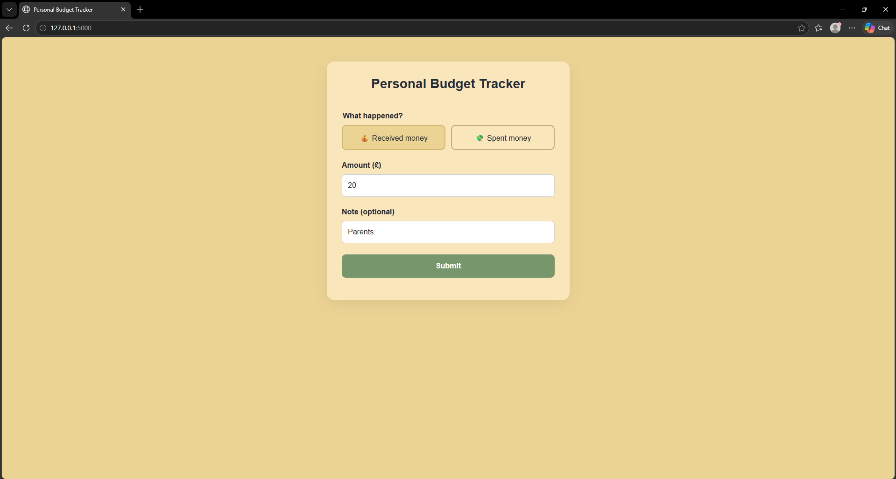
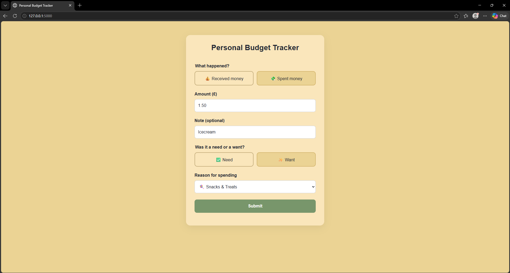
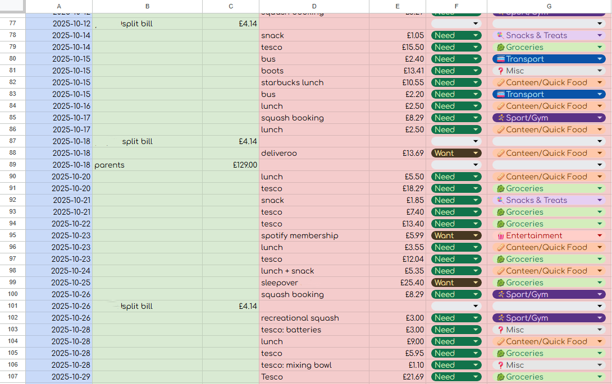
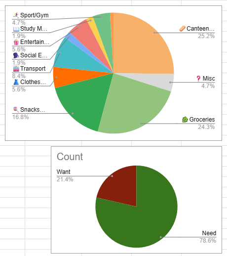
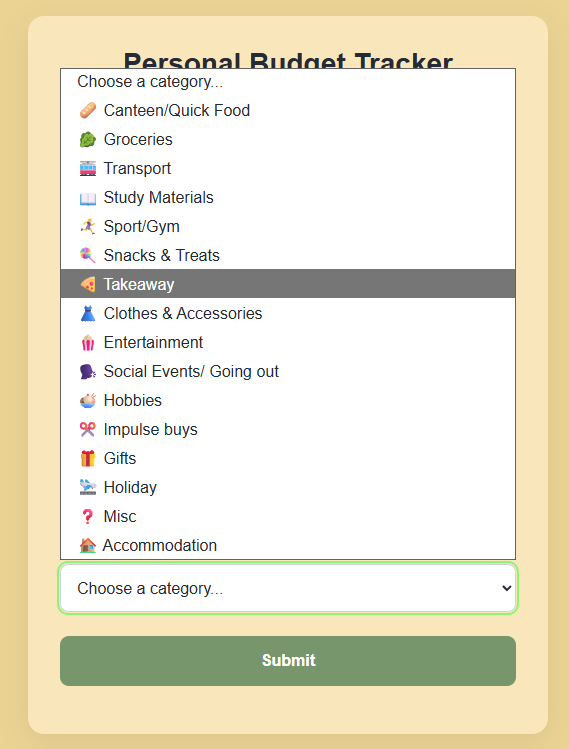

# About the Project

I developed this budget tracker during my first year at university to help me keep track of my daily income and expenses. As I progressed through university life, I realised how important it was to manage my spending and stay within a budget. I initially started by following YouTube tutorials and recreating Google Sheets templates to monitor where my money was going.

However, I wanted to make the process quicker and more convenient. Rather than manually entering the date and navigating a spreadsheet every time I made a transaction, I wanted a simple form that I could reuse with just a few clicks. With connecting the Flask web application to Google Sheet, I could keep my spreadsheet for storing my financial data while using a cleaner, more straightforward interface to record transactions.

Recreating this project after losing the original code was a fun opportunity to revisit my work and think about how I could improve it. There are already several features I'd like to introduce, including the ability to select a date when recording a transaction retrospectively, particularly when I forget to log an expense on the day it occurs.

## Screenshots

### Application interface

### Income


### Expense


### Google Sheets integration
**Note:** The *Need or Want* classification is subjective and may differ from person to person. The categories are intended to help users reflect on their own spending habits rather than enforce a fixed definition.




## Features

- **Record income and expenses** through a simple web interface.
- **Automatic date recording** using UK local time, formatted as DD-MM-YYYY.
- **Spending categorisation** using predefined categories


- **Needs vs wants tracking** to help distinguish essential spending from discretionary purchases.
- **Optional transaction notes** to provide additional context for income and expenses.
- **Google Sheets integration** to store transactions in a spreadsheet.
- **Input validation and feedback** to handle invalid entries and report whether a transaction was saved successfully.
- **Responsive interface** designed to remain usable on smaller screens.

## Technologies Used

| Technology | Purpose |
|---|---|
| Python | Backend logic and transaction processing |
| Flask | Web framework and HTTP routes |
| HTML | Application structure |
| CSS | Styling, layout and responsive design |
| JavaScript | Client-side interaction and form submission |
| Google Sheets API | Persistent transaction storage |
| Google Cloud service account | Authentication with Google Sheets |
| Git and GitHub | Version control and project hosting |

## How It Works

1. The user selects whether they received money or spent money.
2. They enter an amount and can add a note.
3. For expenses, a spending category must be selected and they must indicate whether the purchase was a need or a want.
4. JavaScript submits the transaction to the Flask backend.
5. Flask validates the submitted data and passes valid transactions to the Google Sheets integration.
6. The backend appends the transaction to the configured spreadsheet and returns a success or error message to the interface.

## Getting Started

### Prerequisites

- Python 3.11 or a compatible Python version.
- A Google account.
- A Google Cloud project with the Google Sheets API enabled.
- A Google spreadsheet and a service account with permission to edit it.

### 1. Clone the repository

```bash
git clone https://github.com/daria-295/Budget-Tracker.git
cd Budget-Tracker
```

### 2. Create and activate a virtual environment

On Windows PowerShell:

```powershell
python -m venv .venv
.\.venv\Scripts\Activate.ps1
```

### 3. Install dependencies

```bash
python -m pip install -r requirements.txt
```

### 4. Configure Google Sheets

Create a Google Cloud service account, enable the Google Sheets API, and download its JSON credentials file.

Place the credentials file in the project root and name it:

```text
service_account.json
```

Share your Google spreadsheet with the service account's email address, granting it **Editor** access.

Create a `.env` file in the project root containing:

```dotenv
SPREADSHEET_ID=your_spreadsheet_id
SHEET_NAME=your_worksheet_tab_name
```

Replace the placeholder values with your own spreadsheet ID and worksheet tab name.

The spreadsheet should have the following columns in row 1:

| Date | Income | Amount (Income) | Expenses | Amount (Expenses) | Need or Want | Reason |
|---|---|---|---|---|---|---|

## Google Sheets Template
[Download the template (XLSX)](docs/Google-sheets-templates/Budget%20Tracker%20Google%20Sheets%20%28empty%29.xlsx)

[Download the template (CSV)](docs/Google-sheets-templates/Budget%20Tracker%20Google%20Sheets%20%28empty%29.csv)

### **Security Note !**
Never commit `.env` or `service_account.json` to GitHub. Both are excluded through `.gitignore`. Use your own credentials and spreadsheet when running the application.

### 5. Run the application

```bash
python app.py
```

Open the following address in your browser:

http://127.0.0.1:5000

The application currently runs locally using Flask's development server.

##  Future Improvements

- Display income, expenses and remaining balance.
- Add transaction history, editing and deletion.
- Improve automated testing and error handling.

##  Development Note

This project was recovered and reconstructed from an earlier version. Revisiting it provides an opportunity to improve the codebase, refine the user interface and develop a deeper understanding of backend development, API integration and secure configuration management.

---

**Author:** [Daria](https://github.com/daria-295)

**Repository:** [Budget-Tracker](https://github.com/daria-295/Budget-Tracker)
